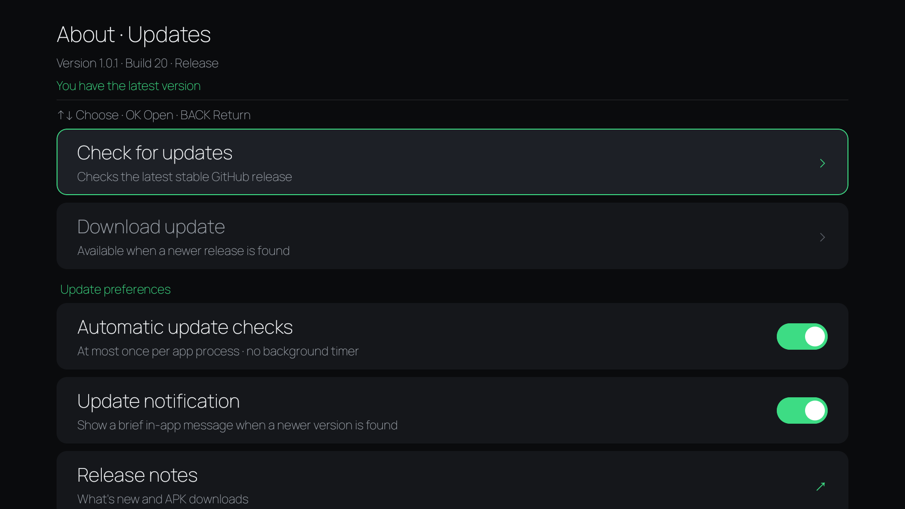

# RecentAppsTV (Fork)

**An Android TV app switcher you can make as clean or informative as you like.**

Choose a starting look, then adjust the details to suit your remote and your TV. Use it with **Usage Access alone**, or optionally connect **Porter / Shizuku** for actual task switching and closing.

[**Download APK**](https://github.com/mds818/RecentAppsTV/releases/latest) · [**Watch the showcase**](#see-it-in-use) · [Getting started](#getting-started)

**Latest download: 1.1.0 · Build 48.** Recent apps or Android tasks, configurable close/dismiss actions, saved profiles with JSON import/export, and refined remote navigation. Updates signed with the same key keep your settings.

## Updates

Open **About → Updates**, with optional startup checks and optional in-app update messages. Downloads and installation start only when you choose them. See [update settings and installation](docs/UPDATES.md).

<details>
<summary>View update settings</summary>



</details>

## Choose your everyday look

Four presets, shown with the same selected app and background. Click a picture to view it at full size.

<table>
  <tr>
    <td width="50%">
      <strong>Default</strong><br>
      <a href="docs/images/default.png"></a><br>
      Names, details and guidance for an informative view.
    </td>
    <td width="50%">
      <strong>Clean</strong><br>
      <a href="docs/images/clean.png"></a><br>
      Centered cards and app names, with fewer distractions.
    </td>
  </tr>
  <tr>
    <td width="50%">
      <strong>Clean+</strong><br>
      <a href="docs/images/clean-plus.png"></a><br>
      An icon-only view with compact padding and hidden controls.
    </td>
    <td width="50%">
      <strong>Classic</strong><br>
      <a href="docs/images/classic.png"></a><br>
      Medium rounded cards, side layout and bottom labels.
    </td>
  </tr>
</table>

## See it in use

https://github.com/user-attachments/assets/5401121b-7119-416a-8c1d-ba1ccf0d87ee

Four looks, one chapter each: **Default → Clean+ → Clean → Classic**. Clean and Classic each show browsing followed by a Spotify close in one continuous take. Both use **Slow** close animation at real playback speed. [Download video](https://github.com/mds818/RecentAppsTV/releases/download/v1.0.1/RecentAppsTV-showcase-1.0.1.mp4).

Presets are starting points. Mix and match the settings afterward. Your previous appearance is saved when you first apply a preset and stays available through further preset changes and app restarts. **Restore previous appearance** brings it back. App lists and service/closing preferences are kept when applying presets.

## Usage & settings tour

https://github.com/user-attachments/assets/4702893b-2990-42bd-8110-215273ae8709

One minute of everyday use and customization: Usage Access without Porter, UP twice to open hidden Settings, card shape and padding, the color chart, optional Porter access, a task closing with **Slow** animation at real speed, and a protected app staying open after Kill All.

## Works without Porter or Shizuku

Porter/Shizuku is **optional**. Everyday app browsing and launching can use Android's Usage Access permission, without root, USB debugging or wireless debugging.

| Mode | What you see | What you can do |
| --- | --- | --- |
| **Usage Access only** | Recently used apps, ordered by foreground usage | Browse and launch apps. History does not mean an app is running. |
| **Porter / Shizuku authorized** | Actual recent Android tasks | Switch tasks, close them and optionally force-stop apps. |

Without privileged access, the app uses Usage Access history. With Porter / Shizuku, choose recent applications or actual Android tasks, and optionally switch views from the overlay. Android tasks are not a list of every background process. You can also turn privileged access off in Settings.

Dismissal hides an app until it is used again; it does not stop it. Configure DOWN and bulk actions separately for use with and without privileged access, and restore dismissed entries when needed.

## Customize the details

Keep only the information and controls you want to see.

| Area | Your choices |
| --- | --- |
| **Layout and cards** | Centered or side selection; older apps to the left or right; card size, square/rounded/circle shape and padding. |
| **Colors and background** | Accent presets and an expanded color chart; background dim level and tint. |
| **Information** | App names, header and remote hints independently on/off; app details off, always on, or only with privileged access. |
| **Navigation and motion** | Show or hide controls; configurable edge shortcuts; elevated or minimal close hints; Fast/Normal/Slow action animation or immediate movement. Hidden Settings remains available with UP twice. |
| **Bulk actions** | Close or dismiss according to the current view/access mode; controls in the app row or at the top, optionally revealed on UP; configurable confirmation. |
| **App lists and protection** | Hide apps, protect apps from Kill All, optionally protect individual closes, and choose whether hidden apps are excluded from Kill All. |

Protected apps are skipped by Close all. Hidden apps are also skipped by default; turn off **Exclude hidden apps from Close all** to include them. Closing requires authorized Porter/Shizuku access. Dismissal of protected apps is controlled separately under **Apps → Protection**.

### Save your own profiles

Open **Appearance presets → My profiles** to save, apply, rename, export or import a configuration. Review every imported setting and undo the last profile application. Missing settings stay unchanged; unsupported settings are skipped with a detailed report. Files contain preferences, not app lists or permissions. Some TVs require a compatible document picker/file manager for file import/export; local profiles work without one. See [profiles and compatibility](docs/PROFILES.md).

## App actions

Hold OK for contextual app actions. DOWN can be configured to close, dismiss, choose automatically, or do nothing according to privileged access. A second press confirms the individual action.

<table>
  <tr>
    <td width="50%">
      <strong>Long-press menu</strong><br>
      <a href="docs/images/context-menu.png"></a>
    </td>
    <td width="50%">
      <strong>Close with a second press</strong><br>
      <a href="docs/images/close-hint.png"></a>
    </td>
  </tr>
</table>

<details>
<summary><strong>See the settings and color chart</strong></summary>


### Settings tour

https://github.com/user-attachments/assets/2ce0d35b-b7cd-4480-8857-4062d9a3311c

The context menu, close hint, preset picker and color chart. [Download video](https://github.com/mds818/RecentAppsTV/releases/download/v1.0.0/RecentAppsTV-settings-tour.mp4).

</details>

## Open it from your remote

For quick everyday access, optionally use a button-remapping app such as [Button Mapper](https://buttonmapper.app/) to launch **Recent Apps** or its **Open Recents** shortcut. Assign a single press, double press or long press where your remote and remapping app support it. Follow that app's setup instructions; availability and permissions vary by device. A remapping app is optional and is not bundled with RecentAppsTV.

For an explicit activity mapping, use `com.websnake.recentstv/.RecentsActivity`.

## Getting started

Android 7.0+ (API 24). Tested on a Xiaomi TV Box running Android 14.

1. Install the APK from [Releases](https://github.com/mds818/RecentAppsTV/releases/latest).
2. Open **Recent Apps** and allow **Usage Access** for recently used app history.
3. Optionally start [Porter](https://porter.darken.eu/setup) or [Shizuku](https://shizuku.rikka.app/guide/setup/) and grant access for task management.
4. Choose an appearance preset, or adjust the settings individually.

No ads, analytics or app account required.

For a remote-button shortcut, use an external remapping app with this component:

```text
com.websnake.recentstv/.RecentsActivity
```

If an existing installation uses a different signing key, Android may require uninstalling it before installing this APK. Uninstalling clears its settings; see [signing and updates](docs/SIGNING.md).

## Remote controls

| Button | Action |
| --- | --- |
| LEFT / RIGHT | Browse apps |
| OK | Open the selected app or control |
| Hold OK | Open the app context menu |
| DOWN twice | Close the selected task when privileged access permits |
| UP | Cancel a close preview or move to the top controls |
| UP twice with Settings hidden | Open Settings |
| MENU | Open Settings |
| BACK | Cancel or dismiss |

When both top controls are visible, Kill All is on the left and Settings is on the right. UP focuses Settings first.

<details>
<summary><strong>Build from source</strong></summary>

Use JDK 17 and Android SDK platform/build-tools 35. Machine-specific Java/SDK paths and signing keys are not committed.

```powershell
./build-local.ps1 -JdkPath C:/path/to/jdk17 -SdkPath C:/path/to/android-sdk -Variant Debug
./build-local.ps1 -JdkPath C:/path/to/jdk17 -SdkPath C:/path/to/android-sdk -Variant Release
```

Alternatively configure JAVA_HOME/local.properties and run `gradlew.bat assembleDebug` or `assembleRelease`. Release output needs external signing. See [signing](docs/SIGNING.md) and [validation](docs/VALIDATION.md).

</details>

## Credits

Based on [Qutaiba-Khader/RecentAppsTV](https://github.com/Qutaiba-Khader/RecentAppsTV). See [project attribution](UPSTREAM.md) and [dependency notices](THIRD_PARTY_NOTICES.md).
